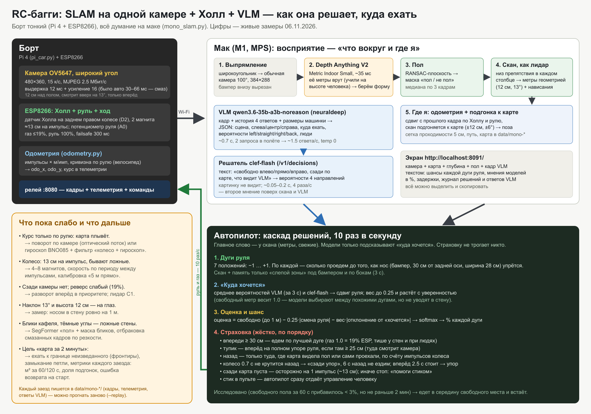

# Прогресс и версии машинки

Цель: дать кодинговому агенту машинку с датчиками, рулём и газом — уехать на 1 км и вернуться.
Шасси одно и то же — багги HW8808RD 1:16 (корпус ~40 см). Меняется всё, что на нём.

## Версии

### v0 — стенд без железа (1–2 сентября)
Релей, веб-пульт, три симулятора машинки одним протоколом, полигон из съёмки телефона (COLMAP → карта →
полигон), обучение автопилота клонированием поведения, панель обучения. Вся петля «камера → решение → руль»
замкнулась без единой железки. Подробно — в [README](../README.md).

### v1 — ESP8266 + ESP32-CAM (3 октября)
Штатное управление сломано — своё. ESP8266 раздаёт точку RC-BUGGY с пультом (captive portal), рампа газа,
failsafe 300 мс. Видео — ESP32-CAM по WebSocket (7–16 к/с). Разъём камеры отошёл, при перепайке плату убили —
камера переехала на Raspberry Pi.

### v2 — Pi + ESP по проводу (3–19 октября)
Pi 4 с камерой OV5647, ESP8266 — контроллер хода и руля по USB, затем Pi Zero 2 W по UART.
Серва оказалась 5-проводной (моторчик + потенциометр без электроники) — руль собран из драйвера DRV8837 и
потенциометра на ESP с калибровкой упоров. Пульт: джойстики, геймпад, OSD как в FPV-очках, настройки газа и руля.
Схемы проводки по фото плат — [docs/wiring](wiring/README.md).

### v3 — камера глубины RealSense D455 (20 октября – 1 ноября)
D455 на Pi 4: глубина в пульте (13 мс), живая 3D-карта (`live_slam.py`), 2D-скан-матчинг «виртуального лидара»,
автопилот-служба (`autopilot.py`): фронтиры, A* по стоимостной карте, pure pursuit, «домой». Pi 4 стал хабом,
4G-модем на борту, пульт из интернета через туннель.
Почему сняли: софт под Pi 4 собран криво, IMU по USB теряет 10–35% времени, на Pi 4 SLAM ~3 к/с (езда рывками),
а камера съедала заряд за ~30 минут.

### v4 — одна камера + датчик Холла + модели (1–6 ноября) ← сейчас
- Борт: Pi 4 (камера + ESP по UART, Zero снята 2 ноября), электроника от повербанка 4×18650 — **503 минуты** на заряде.
- Датчик Холла на заднем правом колесе, 2 магнита (~13 см на импульс) → ESP D2 → одометрия в телеметрии
  ([схема](wiring/hall_sensors.png), [`odometry.py`](../odometry.py)).
- `mono_slam.py` на маке: Depth Anything V2 решает только «пол / не пол», дальность до препятствий — геометрией
  по высоте и наклону камеры, поза — колесо + поворот по камере + подгонка скана к карте.
- Автопилот-исследователь: 7 дуг руля с шансами в %, «куда хочется» от VLM (qwen3.6-35b-a3b-noreason) и
  решателя clef-flash, жёсткая страховка (назад только по карте, разворот вперёд, стоп).
- Экран `localhost:8091`: что видит каждая модель, задержки, решения — текстом для копирования.

## Где сейчас (6 ноября)

| что | цифра |
|---|---|
| кадры с машинки | 15 к/с, задержка кадра на маке ~50–80 мс |
| кадр → скан препятствий | ~40 мс (Depth Anything ~33 мс, M1) |
| решения автопилота | ~10 в секунду |
| VLM | ~1.5 ответа/с, 0.5–1 с на ответ |
| решатель clef-flash | 4 раза/с, 0.05–0.2 с |
| работа электроники от повербанка | 503 мин |

Работает: едет сам, объезжает препятствия по камере, не сдаёт вслепую назад, видно каждое решение.
Не работает: карта комнаты расплывается — курс по рулю неточный, у одной камеры шумные стены; поэтому
локализации пока нет. Проверка пути (колесо против камеры) — `drive_test.py`.

## Дальше

1. Проверить путь по колесу (`drive_test.py`) и курс по камере (поворот руками на 360°).
2. BNO085 — курс с гироскопа; фильтр «колесо + гироскоп».
3. RPLIDAR C1 — настоящая 2D-карта и локализация; камера остаётся для низких препятствий.
4. Исследование к границе неизведанного, замыкание петли; метрика — карта комнаты за 2 минуты.
5. GPS M10 и новый 4G-модем — выход на улицу, к цели 1 км.

Хронология решений по дням — в ленте ontoship, линия «машинка».
