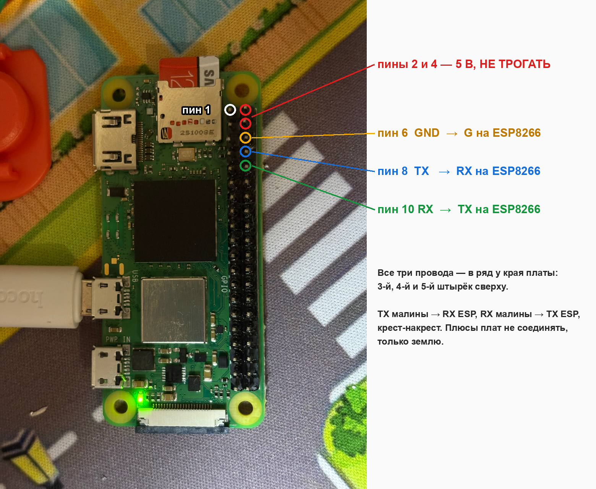
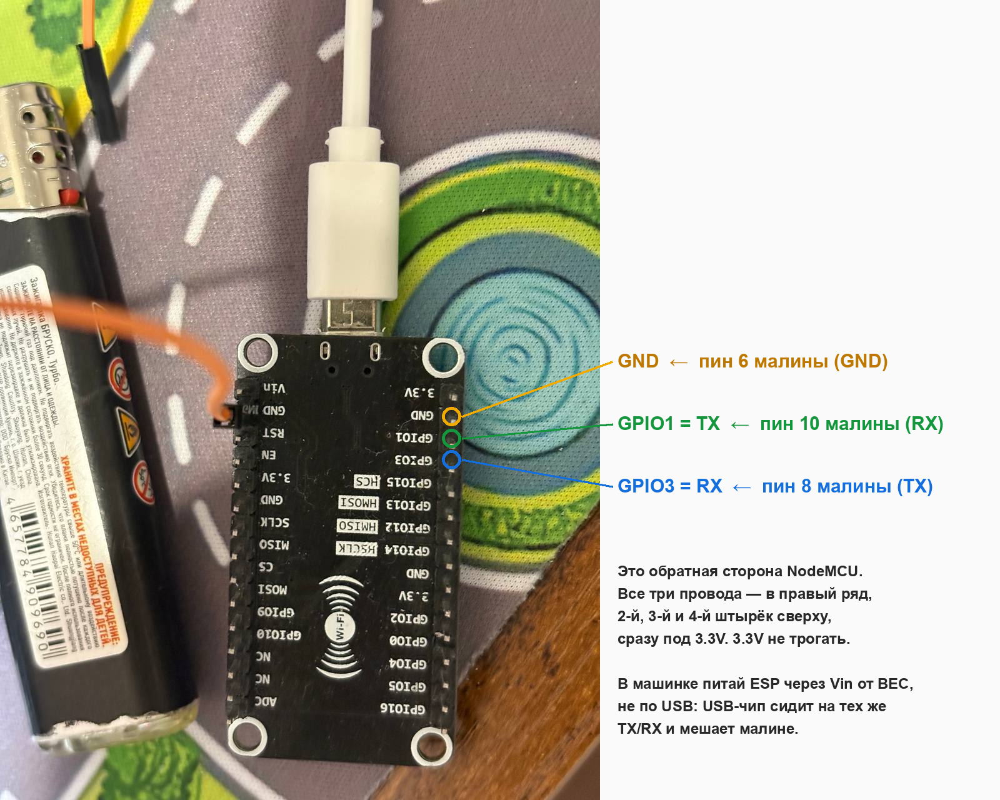
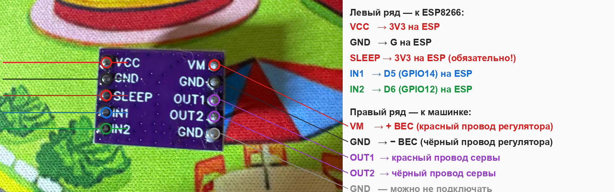
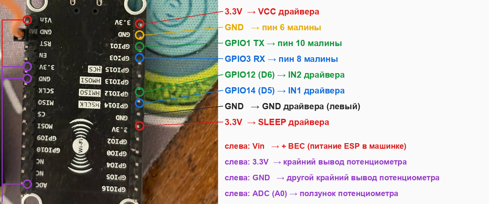

# Проводка борта: Pi Zero 2 W + ESP8266 + DRV8837

Pi Zero 2 W — камера и сеть. ESP8266 (NodeMCU, `firmware/rc_esp`) — ход, руль по
потенциометру и failsafe 300 мс. Связь между ними — UART, команды `c,id,руль,газ`.

## Pi Zero 2 W → ESP8266 (UART)

| Pi Zero | ESP8266 |
|---|---|
| пин 6, GND | GND (правый ряд на обороте, 2-й сверху) |
| пин 8, GPIO14 TX | GPIO3 RX (4-й) |
| пин 10, GPIO15 RX | GPIO1 TX (3-й) |

На Zero: `enable_uart=1`, `dtoverlay=disable-bt`, консоль убрана из `cmdline.txt`,
порт `/dev/serial0 -> ttyAMA0`. Плюсы плат не соединяются, только земля.

## DRV8837 → ESP8266 и машинка

| DRV8837 | Куда |
|---|---|
| VCC | 3.3V ESP |
| GND (левый) | GND ESP |
| SLEEP | 3.3V ESP — без этого драйвер спит (на плате подтяжка к GND) |
| IN1 | D5 / GPIO14 |
| IN2 | D6 / GPIO12 |
| VM | + BEC регулятора (красный) |
| GND (правый) | − BEC регулятора (чёрный) |
| OUT1 / OUT2 | красный / чёрный провод сервы (полярность меняется командой `inv`) |

Потенциометр сервы (жёлтый/белый/коричневый): ползунок → A0 (ADC), крайние → 3.3V и GND.
Ползунок — тот провод, у которого сопротивление к двум другим меняется при повороте колёс.

ESP в машинке питается от BEC через Vin. По USB на столе — можно, но USB-чип NodeMCU
сидит на тех же TX/RX и может мешать малине.
